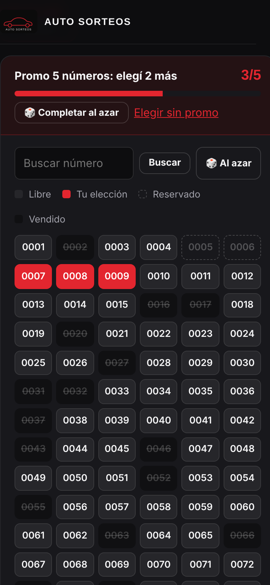
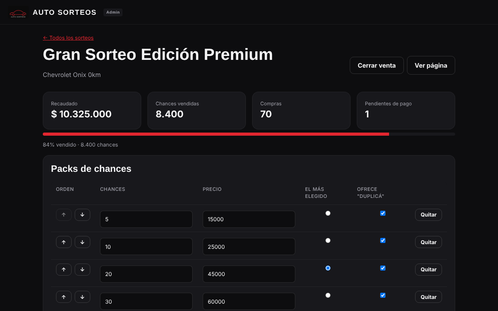

# Giveaway Platform

[](https://github.com/MarianoMuri/giveaway-platform/actions/workflows/ci.yml)


Plataforma web para organizar **sorteos en vivo de autos 0km**: los participantes eligen sus números (o una promo por cantidad), pagan con **Mercado Pago** y siguen el sorteo por YouTube. El organizador administra todo desde un panel: sorteos, ventas, ventas manuales, número ganador y exportación de compradores.

Desarrollada para una concesionaria y publicada como versión **white-label**: la marca de cada cliente (nombre, logo, colores, redes) se configura en un solo archivo y queda fuera del repositorio.

<p align="center">
  
  &nbsp;
  
</p>

<p align="center">
  
</p>

## Funcionalidades

**Para el participante**
- Grilla de números en tiempo real (libres, reservados, vendidos), búsqueda y elección al azar.
- **Promos por cantidad** (ej. 1 × $10.000, 2 × $15.000, 5 × $30.000): al elegir una promo, el sistema guía la selección con un contador y lleva al pago al completar.
- Siempre cobra la combinación más barata de promos y muestra el ahorro.
- Pago con Mercado Pago Checkout Pro y página de estado de la compra que funciona como comprobante.
- Página de links para la bio de Instagram, con el sorteo activo y las redes.

**Para el organizador**
- Crear sorteos, publicar, cerrar la venta y editar promos.
- Recaudación, números vendidos, reservados y libres.
- Venta manual (efectivo o transferencia).
- Carga del número ganador con los datos del comprador.
- Exportación de compradores a CSV (Excel).

## Lo técnico más interesante

- **Sin números duplicados:** reserva con `SELECT … FOR UPDATE` dentro de una transacción; dos compras simultáneas del mismo número no pueden prosperar.
- **Reservas que vencen:** el número queda reservado 15 minutos mientras se paga y se libera solo si el pago no llega.
- **Webhook seguro e idempotente:** valida la firma `x-signature` de Mercado Pago, consulta el pago a la API (no confía en el aviso) y controla el monto. Avisos repetidos no duplican ventas.
- **Casos borde contemplados:** pagos acreditados tarde o con monto distinto quedan en estado `needs_review` para reintegro.
- **Precio óptimo con promos:** programación dinámica (problema de la mochila no acotada) para cobrar la combinación más barata.
- **Modo demo:** una API simulada dentro del navegador permite mostrar el producto completo sin servidor.

Más detalle en [`docs/ARCHITECTURE.md`](docs/ARCHITECTURE.md).

## Stack

| Capa | Tecnologías |
|---|---|
| Backend | Node.js 22, Express 5, Sequelize, PostgreSQL, JWT, bcrypt, Helmet, rate limiting |
| Pagos | Mercado Pago Checkout Pro + Webhooks |
| Frontend | React 18 (Create React App), React Router |
| Tests | `node:test` + Supertest (SQLite en memoria) |
| Infra | Docker, Docker Compose, GitHub Actions |

## Cómo correrlo

Requisitos: Node 22 y Docker (opcional).

```bash
# Backend
cd backend
cp .env.example .env        # completar valores
npm install
npm test                    # tests del flujo de compra y de precios
npm run dev                 # API en http://localhost:4000

# Frontend
cd frontend
npm install
npm start                   # http://localhost:3000

# Demo sin backend (API simulada en el navegador)
REACT_APP_DEMO=true npm start
```

Con Docker: `docker compose up --build` levanta la API y PostgreSQL.

Para probar pagos se usan las **credenciales y usuarios de prueba** de Mercado Pago, y el webhook se expone en local con `ngrok http 4000`.

## API

| Método | Ruta | Descripción |
|---|---|---|
| GET | `/api/raffles` | Sorteos publicados |
| GET | `/api/raffles/:id/numbers` | Estado de la grilla (`0` libre, `1` reservado, `2` vendido) |
| POST | `/api/orders` | Reserva números y devuelve la URL de pago |
| GET | `/api/orders/:id` | Estado de una compra |
| GET | `/api/raffles/:id/packs` | Packs a la venta con el total de "Duplicá" ya calculado |
| POST | `/api/raffles/:id/quote` | Cotización de una compra (`packId`, `double`): el total lo calcula siempre el backend |
| GET | `/api/courses` | Cursos activos |
| GET | `/api/courses/download?token=` | Descarga del PDF con link firmado y con vencimiento |
| POST | `/api/webhooks/mercadopago` | Notificaciones de pago |
| POST | `/api/admin/login` | Login del administrador (JWT) |
| GET/PUT | `/api/admin/raffles/:id/packs` | Packs del sorteo y oferta "Duplicá" (alta, edición y baja en una transacción) |
| GET/POST/PATCH/DELETE | `/api/admin/courses` | ABM de cursos con subida de PDF (`multipart/form-data`) |
| … | `/api/admin/*` | Sorteos, estadísticas, ventas, ganador, exportación |

## Cómo se trabaja

Sprints semanales con milestones e issues en GitHub, ramas `feature/*` hacia `develop`, Pull Requests con CI y Conventional Commits. Ver [`CONTRIBUTING.md`](CONTRIBUTING.md) y el [`roadmap`](docs/ROADMAP.md).

## Aviso

Este software es una herramienta técnica. La mecánica comercial y legal de cada sorteo (autorizaciones, bases y condiciones, modalidad "sin obligación de compra") es responsabilidad del organizador según la normativa de su jurisdicción.

## Autor

**Mariano Murinigo** · Técnico Universitario en Programación (UTN)
[LinkedIn](https://www.linkedin.com/in/mariano-iv%C3%A1n-murinigo-3b4826a6/) · [GitHub](https://github.com/MarianoMuri)
