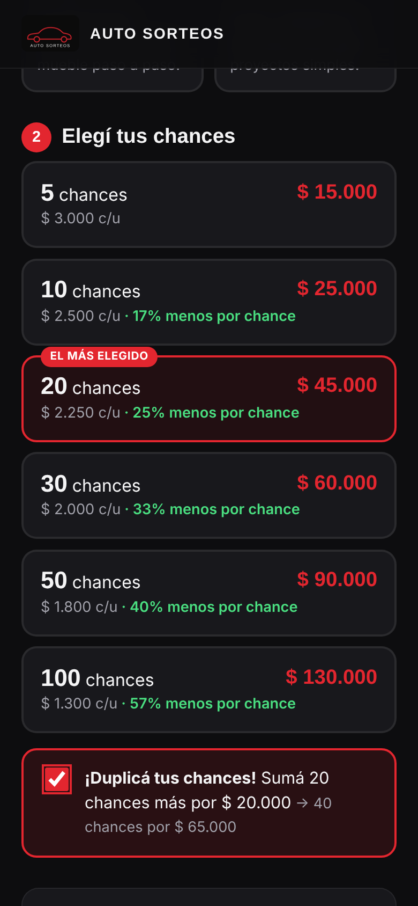
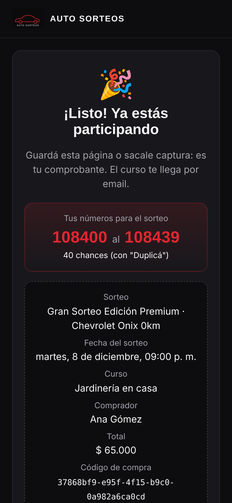
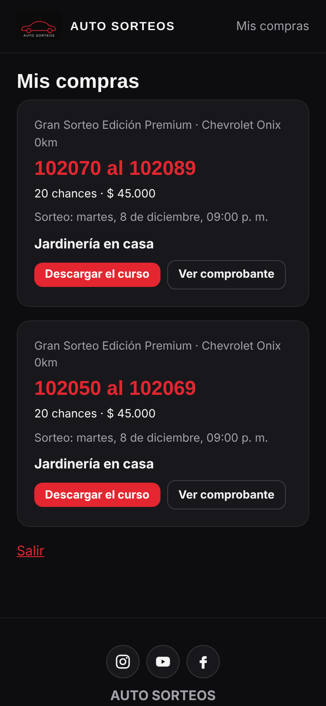

# Giveaway Platform

[](https://github.com/MarianoMuri/giveaway-platform/actions/workflows/ci.yml)


Plataforma web para organizar **sorteos en vivo** con un modelo de **venta de cursos digitales**: el participante compra un curso y recibe chances de regalo para el sorteo. Paga con **Mercado Pago**, recibe sus números automáticamente al acreditarse el pago y sigue el sorteo por YouTube. El organizador administra todo desde un panel: cursos, packs de chances, ventas, ventas manuales, número ganador y exportación de compradores.

Desarrollada para una concesionaria y publicada como versión **white-label**: la marca de cada cliente (nombre, logo, colores, redes) se configura en un solo archivo y queda fuera del repositorio.

<p align="center">
  
  &nbsp;
  
  &nbsp;
  
  &nbsp;
  
</p>

<p align="center">
  
</p>

## Funcionalidades

**Para el participante**
- Elige un curso y un pack de chances. Cada pack muestra el precio por chance y el ahorro real contra el pack más chico, sin precios tachados inventados.
- Oferta **"Duplicá tus chances"**: el doble de chances pagando un extra por chance.
- Paga con Mercado Pago Checkout Pro (también en efectivo, porque no hay reserva que pueda vencer).
- Recibe sus números **consecutivos** (desde el 100000) apenas se acredita el pago, en una página que funciona como comprobante.
- Le llega un **email de confirmación** con sus números, el botón para descargar el curso y los datos del sorteo. Desde su compra, o desde **Mis números** (con solo su DNI, sin contraseña ni mail; el curso se baja con DNI y el email de la compra), puede volver a ver sus números y descargar el curso cuando quiera.
- Barra de progreso de chances vendidas y bases y condiciones con los precios de cada pack.
- Página de links para la bio de Instagram, con el sorteo activo y las redes.

**Para el organizador**
- ABM de cursos con subida del PDF; la descarga se hace con links firmados que vencen.
- Packs de chances y oferta "Duplicá" editables por sorteo, con vista previa de lo que ve el comprador.
- Recaudación, chances vendidas, compras, pendientes y compras para revisar.
- Venta manual (efectivo o transferencia) con asignación de números en el acto.
- **Sorteo en vivo** en pantalla completa (azar seguro del servidor entre números válidos), historial de sorteos, repetición con motivo y **registro de auditoría**.
- **Buscador** por número, DNI, email o nombre, con la ficha de cada compra (n° de operación de Mercado Pago, historial) y exportación del listado completo.
- **Cierre de ventas** con fecha y botón "Consultar" para saber si están todos los clientes cargados antes de sortear.
- **Reintegros y contracargos**: la compra pasa a anulada, sus números quedan anulados con fecha y motivo y se ve el historial de estados.
- **Participación gratuita** (sin obligación de compra): lista de participantes, anulación y activación por sorteo.
- **Requisitos legales y provincias**: N° de autorización, bases y condiciones y provincias excluidas; sin los dos primeros no se abre la venta.
- Estado del email de cada compra (enviado, pendiente, falló) y reenvío, incluso a una dirección corregida.
- Carga del número ganador con los datos del comprador.
- Exportación de compradores a CSV (Excel).

## Lo técnico más interesante

- **Números sin duplicados aunque los pagos lleguen a la vez:** cada sorteo tiene un contador que se incrementa con un único `UPDATE … RETURNING` atómico, más un índice único `(sorteo, número)` como red de seguridad. Probado con pagos simultáneos contra **PostgreSQL real en el CI**.
- **Webhook seguro e idempotente:** valida la firma `x-signature` de Mercado Pago, consulta el pago a la API (no confía en el aviso), controla el monto y bloquea la orden (`FOR UPDATE`). Avisos repetidos no asignan números de nuevo.
- **Emails con patrón outbox:** el mail queda pendiente en la misma transacción que aprueba el pago, se envía después del commit y se reintenta con espera creciente si el proveedor falla. Un `UPDATE` condicional evita mandarlo dos veces.
- **El total lo calcula siempre el backend**, en centavos enteros. El frontend solo muestra lo que devuelve la API.
- **Archivos seguros:** el PDF se valida por contenido (magic bytes), se guarda fuera del repo detrás de una interfaz intercambiable (disco hoy, S3/R2 después) y se descarga con un JWT de propósito único que vence.
- **Modo demo:** una API simulada dentro del navegador permite mostrar el producto completo sin servidor.

Más detalle en [`docs/ARCHITECTURE.md`](docs/ARCHITECTURE.md).

## Stack

| Capa | Tecnologías |
|---|---|
| Backend | Node.js 22, Express 5, Sequelize, PostgreSQL, JWT, bcrypt, Helmet, rate limiting |
| Pagos | Mercado Pago Checkout Pro (API de Orders) + Webhooks |
| Email | API HTTPS de Resend (o SMTP con Nodemailer: Brevo, etc.) |
| Frontend | React 18 (Create React App), React Router |
| Tests | `node:test` + Supertest, con SQLite en memoria y PostgreSQL 16 en el CI |
| Infra | Docker, Docker Compose, GitHub Actions |

## Cómo correrlo

Requisitos: Node 22 y Docker (opcional).

```bash
# Backend
cd backend
cp .env.example .env        # completar valores
npm install
npm test                    # tests del flujo de compra y de precios
npm run dev                 # API en http://localhost:4000

# Frontend
cd frontend
npm install
npm start                   # http://localhost:3000

# Demo sin backend (API simulada en el navegador)
REACT_APP_DEMO=true npm start
```

Con Docker: `docker compose up --build` levanta la API y PostgreSQL (aplica las migraciones antes de arrancar).

### Base de datos: migraciones

Con `DATABASE_URL` (PostgreSQL) el esquema lo cambian **solo las migraciones**; la API no crea ni modifica tablas y se niega a arrancar si faltan migraciones. Sin `DATABASE_URL` (SQLite, desarrollo) crea el esquema sola.

```bash
cd backend
npm run migrate            # aplica las migraciones pendientes (también en cada deploy)
npm run migrate:status     # qué está aplicado y qué falta
npm run migrate:undo       # deshace la última
npm run seed               # datos de desarrollo: un sorteo activo con sus packs (nunca en producción)
```

Cada cambio de modelo lleva su migración en `backend/migrations/` (un archivo nuevo, nunca editar uno ya aplicado). Un test compara el esquema de las migraciones con el de los modelos y falla si falta alguna.

El paso a paso para publicarlo (Railway, Netlify, dominio y Mercado Pago) está en [docs/DEPLOY.md](docs/DEPLOY.md).

Para probar pagos se usan las **credenciales y usuarios de prueba** de Mercado Pago, y el webhook se expone en local con `ngrok http 4000`.

## API

| Método | Ruta | Descripción |
|---|---|---|
| GET | `/api/raffles` | Sorteos publicados, con chances vendidas y precio desde |
| GET | `/api/raffles/:id/packs` | Packs a la venta: precio por chance, ahorro real y total con "Duplicá" |
| POST | `/api/raffles/:id/quote` | Cotización de una compra (`packId`, `double`) |
| POST | `/api/raffles/:id/purchases` | Compra de curso + pack (`courseId`, `packId`, `double`, `buyer`): devuelve el link de pago |
| GET | `/api/orders/:id` | Estado de una compra y números asignados |
| POST | `/api/orders/:id/download-link` | Link de descarga nuevo del curso de una compra pagada |
| POST | `/api/my-purchases/by-dni` | Devuelve los números de un DNI (solo lectura, nombre abreviado; límite por IP y DNI, captcha) |
| POST | `/api/my-purchases/download` | Link de descarga del curso: exige DNI + email de esa compra |
| POST | `/api/my-purchases/link` | Envía por email el link de acceso a "Mis números" (responde igual exista o no el email) |
| GET | `/api/my-purchases` | Compras acreditadas del dueño del link (header `Authorization: Bearer <token>`) |
| POST | `/api/raffles/:id/free-entries` | Pide participar gratis (nombre, DNI, email, captcha); manda el link de confirmación |
| POST | `/api/free-entries/confirm` | Confirma el email con el link y asigna el número |
| GET | `/api/courses` | Cursos activos |
| GET | `/api/courses/download?token=` | Descarga del PDF con link firmado y con vencimiento |
| POST | `/api/webhooks/mercadopago` | Notificaciones de pago: asigna los números al aprobarse |
| POST | `/api/admin/login` | Login del administrador (JWT) |
| GET/PUT | `/api/admin/raffles/:id/packs` | Packs del sorteo y oferta "Duplicá" (alta, edición y baja en una transacción) |
| GET/POST/PATCH/DELETE | `/api/admin/courses` | ABM de cursos con subida de PDF (`multipart/form-data`) |
| GET | `/api/admin/raffles/:id/free-entries` | Participaciones gratuitas del sorteo |
| POST | `/api/admin/free-entries/:id/void` | Anula una participación gratuita |
| POST | `/api/admin/orders/manual` | Venta manual: asigna los números en el acto |
| POST | `/api/admin/raffles/:id/draw` | Sorteo en vivo: elige al azar entre los números válidos (repetir exige `reason`) |
| GET | `/api/admin/raffles/:id/draws` | Historial de sorteos del sorteo |
| GET | `/api/admin/audit?raffleId=&limit=` | Registro de auditoría (solo lectura) |
| GET | `/api/admin/raffles/:id/search?q=` | Busca por número, DNI, email o nombre (compras y participaciones gratuitas) |
| POST | `/api/admin/raffles/:id/readiness` | Control previo al sorteo: carga pagos faltantes (consulta a Mercado Pago) y resume el estado |
| GET | `/api/admin/orders/:id/history` | Historial de estados de una compra (acreditada, reintegrada, contracargo) |
| POST | `/api/admin/orders/:id/resend-email` | Reenvía el email de confirmación (opcional: a otra dirección) |
| POST | `/api/admin/raffles/:id/winner` | Busca al dueño del número ganador |
| … | `/api/admin/*` | Sorteos, estadísticas, compras, exportación CSV |

## Cómo se trabaja

Sprints semanales con milestones e issues en GitHub, ramas `feature/*` hacia `develop`, Pull Requests con CI y Conventional Commits. Ver [`CONTRIBUTING.md`](CONTRIBUTING.md) y el [`roadmap`](docs/ROADMAP.md).

## Aviso

Este software es una herramienta técnica. La mecánica comercial y legal de cada sorteo (autorizaciones, bases y condiciones, modalidad "sin obligación de compra") es responsabilidad del organizador según la normativa de su jurisdicción. En [docs/LEGAL.md](docs/LEGAL.md) hay un resumen de lo que conviene revisar con un abogado antes de vender y un borrador de bases.

## Autor

**Mariano Murinigo** · Técnico Universitario en Programación (UTN)
[LinkedIn](https://www.linkedin.com/in/mariano-iv%C3%A1n-murinigo-3b4826a6/) · [GitHub](https://github.com/MarianoMuri)
