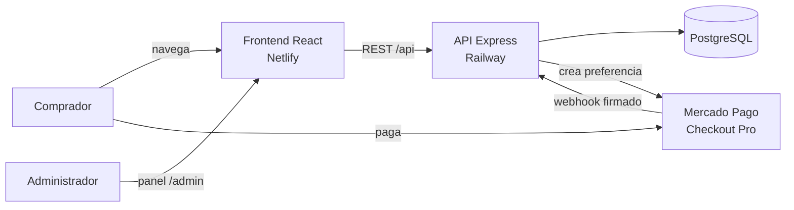
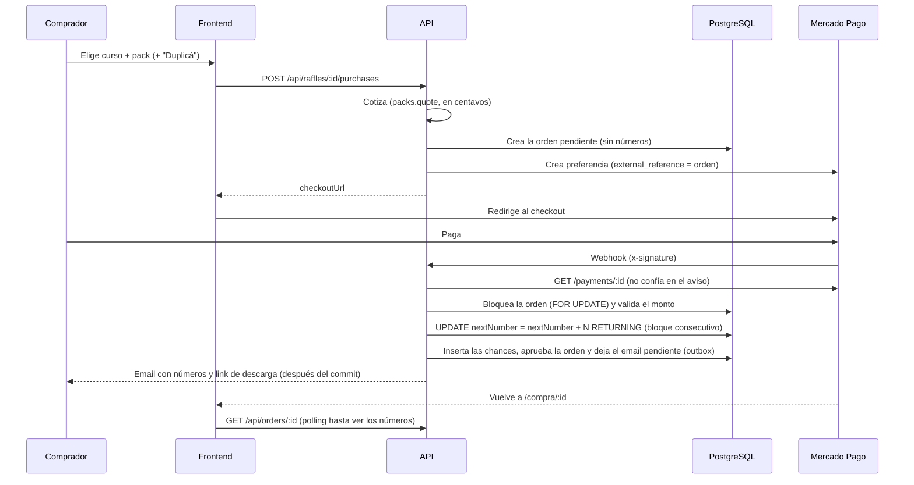

# Arquitectura

## Vista general



## Flujo de compra



## Decisiones

| Decisión | Motivo |
|---|---|
| Números asignados recién al confirmarse el pago | El comprador elige un pack, no números. Sin reserva previa no hay números "tomados" por compras que nunca se pagan, ni vencimientos que administrar. |
| Contador por sorteo con un `UPDATE … RETURNING` atómico | La base serializa los UPDATE sobre la misma fila: pagos simultáneos reciben bloques distintos. Se evita "leer y después escribir", donde aparecen los duplicados. |
| Índice único `(RaffleId, number)` | Red de seguridad: la base rechaza un número repetido aunque haya un bug en la lógica. |
| El contador nunca retrocede | Un número anulado (reintegro, contracargo) no se vuelve a asignar: cada número identifica una sola compra para siempre. |
| Consultar el pago a Mercado Pago en el webhook | El cuerpo del aviso no es confiable; se valida firma, estado y monto contra la API. |
| Webhook idempotente con la orden bloqueada | Mercado Pago reintenta avisos; procesar dos veces el mismo pago no asigna números de nuevo. |
| Estado `needs_review` | Pagos con un monto distinto al de la orden quedan para revisión manual y reintegro. |
| Email con patrón outbox | El mail se marca pendiente en la transacción que aprueba el pago: si el servidor se cae, no se pierde. El envío ocurre después del commit, así el webhook responde rápido y un SMTP caído no rompe la compra. |
| Reintentos con espera creciente (1, 5, 15, 60 y 360 min) | Un proveedor caído un rato no deja compradores sin su comprobante; después de 6 intentos queda "falló" para reenviar desde el panel. |
| "Claim" con `UPDATE` condicional antes de enviar | Si el envío inmediato y el proceso periódico coinciden, solo uno manda el mail. |
| "Mis compras" con link mágico, sin cuentas ni contraseñas | El comprador ya dio su email al comprar; un link de corta vida a esa casilla alcanza para probar que es suyo y no suma una contraseña más que olvidar. |
| Respuesta idéntica exista o no el email | Evita que alguien averigüe quién compró probando direcciones (anti-enumeración). |
| Token con propósito propio (`my-purchases`) y vencimiento de 30 min | Un link de descarga o un token de admin no abre las compras, y uno robado vence rápido. El token viaja en el header, no en la URL de la API, y el frontend lo saca de la barra de direcciones apenas lo lee. |
| Un pedido de link por email por minuto, más límite por IP | Impide usar el sistema para llenar de mails la casilla de otra persona. Hoy el control por email vive en memoria; con varias instancias se mueve a la base o a Redis. |
| El azar lo hace el servidor con `crypto.randomInt`, no el navegador | El resultado no puede manipularse desde la pantalla ni depende de la animación (que es solo ambientación). Se elige una posición entre los N números válidos ordenados; se guarda N y la posición, así cualquiera puede verificar que ese número ocupa ese lugar. |
| Sortear descarta a quien tiene el pago reintegrado | Antes de confirmar al ganador se consulta a Mercado Pago por su pago; si ya no está vigente se anula, se registra el descarte y se sortea otra vez (hasta 5 intentos). |
| Repetir el sorteo exige motivo y no borra el anterior | Un ganador que no responde o un error son casos reales, pero repetir sin explicación parece manipulación. El sorteo anterior queda "reemplazado" con su motivo. |
| Dos administradores no pueden pisarse | Cargar el ganador usa una actualización condicional (compare-and-swap): si cambió el estado mientras tanto, falla con un aviso en vez de sobrescribir en silencio. |
| Auditoría append-only y sin datos personales | La API solo permite agregar y leer: no hay rutas para editar ni borrar. Se registra qué se hizo y cuándo, no DNI, emails ni contraseñas (el log no debe volverse otra fuente de datos personales). Límite conocido: quien administre la base de datos podría alterarla; para eso haría falta exportarla a un sistema externo. |
| El buscador distingue por forma: 6 dígitos = número, 7-8 = DNI, otro = texto | Los números arrancan en 100000 y los DNI tienen 7 u 8 dígitos, así que no se pisan y el administrador usa un solo campo. DNI y número son exactos; email y nombre buscan parcial sin distinguir mayúsculas, con `%` y `_` tratados como texto. Máximo 50 resultados por tipo. |
| CSV con defensa contra inyección de fórmulas | Nombre y email los escribe cualquiera desde el formulario público; una celda que empiece con `=` se ejecutaría al abrirla en Excel. Se antepone un apóstrofe. |
| El cierre de ventas se calcula al consultar, sin proceso programado | "Abierta" = sorteo activo y fecha de cierre no vencida. Un cron que cierre sorteos podría fallar o demorarse justo en el momento más sensible; calcularlo en cada consulta no puede quedar desfasado. |
| Compra iniciada antes del cierre y pagada después: se respeta | El comprador cumplió en tiempo (ej. pago en efectivo que tarda días); descartarlo sería injusto. Por eso existe la consulta previa al sorteo: la lista no está cerrada hasta que no quedan pagos en proceso. |
| "Consultar" pregunta a MP por cada compra pendiente reciente | Si se pierde un aviso (webhook), un cliente pagó pero no figura. La consulta busca el pago por `external_reference` y lo carga con el mismo camino que el webhook (mismas garantías: idempotente, con lock). Solo mira compras de las últimas `PENDING_GRACE_HOURS` (24 h por defecto) y hasta 2.000 por consulta. |
| El ganador solo se carga con la venta cerrada | Mientras la venta está abierta todavía pueden entrar números; sortear antes dejaría a alguien afuera. |
| Reintegro / contracargo anulan la compra, no la borran | Los números quedan en la base como "anulado" con fecha y motivo: nunca se reutilizan (los vio un comprador) y queda el rastro para un reclamo. Solo cuenta el aviso del pago que acreditó la compra, para que un intento anterior no la anule por error. |
| Verificar el pago en MP antes de dar un ganador | Un número anulado no puede ganar. El webhook puede tardar o perderse, así que al cargar el ganador se consulta a MP por ese pago puntual (una sola consulta): si está reintegrado o con contracargo se anula y se sortea de nuevo. Si MP no responde, se frena en vez de arriesgarse a premiar un pago caído. Un contracargo posterior al sorteo no se puede evitar: el panel lo avisa. |
| Historial de estados en tabla propia (`OrderEvent`) | Una compra cambia de estado por avisos externos (MP); guardar cada cambio con fecha permite explicar qué pasó. Se escribe en la misma transacción que el cambio, así no puede quedar uno sin el otro. |
| Reintegro parcial no anula | MP lo informa como pago aprobado con detalle `partially_refunded`; anular todos los números por un reintegro chico sería injusto. Queda para decidir con el cliente. |
| Participación gratuita en su propia tabla (`FreeEntry`) | Tiene reglas distintas a una compra (DNI único, confirmación por email, anulación) y no debe mezclarse con ventas ni recaudación. Comparte el contador de números del sorteo, así que nunca repite un número. |
| Índice único `(RaffleId, DNI)` | "1 número por DNI" lo garantiza la base, aunque dos pedidos lleguen a la vez. |
| El número se asigna al confirmar el email, no al pedirlo | Hasta confirmar no se reserva nada: nadie puede "ocupar" el DNI de otro. Un pedido nuevo con el mismo DNI pisa al anterior sin confirmar. |
| Link de confirmación guardado solo como hash | Si se filtra la base, no se pueden confirmar participaciones ajenas. |
| Captcha, límite por IP y por dispositivo, con hashes | El captcha frena bots; el límite por IP es configurable porque muchas personas comparten conexión (datos móviles); el dispositivo es un identificador del navegador y se puede borrar, por eso no es la defensa principal. Se guarda un hash, no el dato (datos personales). |
| Límite conocido: el DNI no se verifica en línea | Alguien puede usar un DNI ajeno. Se mitiga con el captcha, los límites, la anulación desde el panel y la acreditación de identidad del ganador al entregar el premio. |
| Total calculado en el backend, en centavos enteros | El total que se cobra nunca depende del navegador, y no hay errores de coma flotante. |
| Ahorro calculado contra el pack más chico | Se muestra un ahorro real (precio por chance), no precios "antes" inventados. |
| Packs que conservan su id al editarse | Las compras los referencian; se actualizan, crean y borran dentro de una transacción. |
| PDF validado por contenido y descargado con un JWT de propósito único | Un archivo renombrado no pasa como PDF, y un token de sesión no sirve como link de descarga. |
| Tests de concurrencia contra PostgreSQL en el CI | SQLite no admite transacciones en paralelo; la garantía se prueba en la misma base que producción. |
| Marca como configuración (`brand.js`) | El mismo código sirve para varios clientes; los datos de cada cliente quedan fuera del repo. |
| Modo demo con API simulada | Permite mostrar el producto completo sin servidor ni cobros reales. |
| Migraciones versionadas en vez de `sync()` | `sync()` solo crea tablas que faltan: no agrega columnas a una base con datos, así que una actualización dejaría la producción rota. Las migraciones son archivos ordenados que cambian el esquema paso a paso, conservan los datos y se pueden deshacer. La API no toca el esquema y no arranca si faltan, para no correr con una base a medias. Un test las compara con los modelos. |

## Estructura

```
backend/
  src/
    config.js            variables de entorno
    db.js                modelos Sequelize: Raffle, Pack, Course, Order, Chance
    routes/              public, admin, courses, webhooks
    services/
      packs.js           packs, oferta "Duplicá" y cotización (única fuente del total)
      purchases.js       compra de curso + pack y confirmación del pago
      numbers.js         asignación de números consecutivos
      orders.js          sorteos, webhook, venta manual, ganador, estadísticas
      courses.js         cursos y links de descarga firmados
      emails.js          envío del email de confirmación (outbox + reintentos)
      emailTemplates.js  plantilla HTML responsive
      mailer.js          transporte SMTP (o consola en desarrollo)
      storage.js         almacenamiento de archivos (disco hoy, S3/R2 después)
      mercadopago.js     preferencia, consulta de pago, firma del webhook
  test/                  tests de integración (node:test + supertest)
frontend/
  src/
    brand.js             nombre, colores, logo y redes del cliente
    pages/               landing, compra, estado, bases, links, admin
    components/          editor de packs, barra de progreso, redes
    demo/                API simulada para la demo
```
| La API se niega a arrancar con configuración incompleta en producción | Un error claro al desplegar es mejor que descubrir en plena venta que no salen los mails, que el captcha está apagado o que el webhook no se valida. Lista todo lo que falta de una vez. |
| PDF en un volumen persistente, no en el repo ni en la base | El disco de Railway se borra en cada deploy; el volumen sobrevive. La interfaz de `storage.js` permite pasar a almacenamiento de objetos (R2/S3) más adelante sin tocar el resto. |
| Monitor de Mercado Pago con dos fallos seguidos para alertar, y estado en memoria | Un tropiezo de red no debe alarmar al cliente, pero una caída real (token vencido, Mercado Pago sin servicio) hay que enterarse antes de que se pierdan ventas. Avisa una vez, recuerda cada 6 horas y avisa al recuperarse. Guardar el estado en la base no aporta: si el servidor se reinicia, vuelve a verificar y, como máximo, repite un aviso. |
