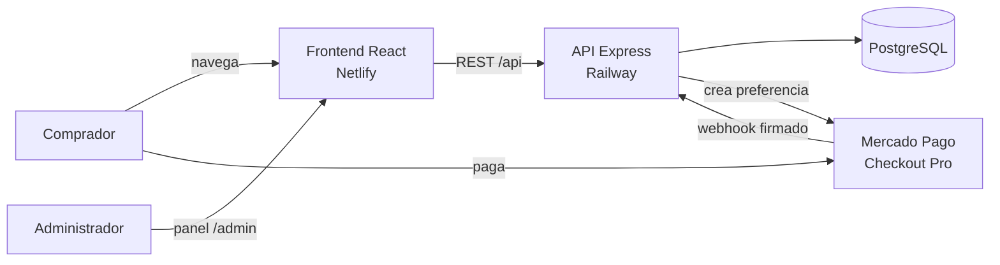
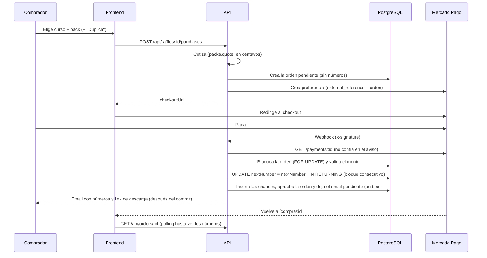

# Arquitectura

## Vista general



## Flujo de compra



## Decisiones

| Decisión | Motivo |
|---|---|
| Números asignados recién al confirmarse el pago | El comprador elige un pack, no números. Sin reserva previa no hay números "tomados" por compras que nunca se pagan, ni vencimientos que administrar. |
| Contador por sorteo con un `UPDATE … RETURNING` atómico | La base serializa los UPDATE sobre la misma fila: pagos simultáneos reciben bloques distintos. Se evita "leer y después escribir", donde aparecen los duplicados. |
| Índice único `(RaffleId, number)` | Red de seguridad: la base rechaza un número repetido aunque haya un bug en la lógica. |
| El contador nunca retrocede | Un número anulado (reintegro, contracargo) no se vuelve a asignar: cada número identifica una sola compra para siempre. |
| Consultar el pago a Mercado Pago en el webhook | El cuerpo del aviso no es confiable; se valida firma, estado y monto contra la API. |
| Webhook idempotente con la orden bloqueada | Mercado Pago reintenta avisos; procesar dos veces el mismo pago no asigna números de nuevo. |
| Estado `needs_review` | Pagos con un monto distinto al de la orden quedan para revisión manual y reintegro. |
| Email con patrón outbox | El mail se marca pendiente en la transacción que aprueba el pago: si el servidor se cae, no se pierde. El envío ocurre después del commit, así el webhook responde rápido y un SMTP caído no rompe la compra. |
| Reintentos con espera creciente (1, 5, 15, 60 y 360 min) | Un proveedor caído un rato no deja compradores sin su comprobante; después de 6 intentos queda "falló" para reenviar desde el panel. |
| "Claim" con `UPDATE` condicional antes de enviar | Si el envío inmediato y el proceso periódico coinciden, solo uno manda el mail. |
| "Mis compras" con link mágico, sin cuentas ni contraseñas | El comprador ya dio su email al comprar; un link de corta vida a esa casilla alcanza para probar que es suyo y no suma una contraseña más que olvidar. |
| Respuesta idéntica exista o no el email | Evita que alguien averigüe quién compró probando direcciones (anti-enumeración). |
| Token con propósito propio (`my-purchases`) y vencimiento de 30 min | Un link de descarga o un token de admin no abre las compras, y uno robado vence rápido. El token viaja en el header, no en la URL de la API, y el frontend lo saca de la barra de direcciones apenas lo lee. |
| Un pedido de link por email por minuto, más límite por IP | Impide usar el sistema para llenar de mails la casilla de otra persona. Hoy el control por email vive en memoria; con varias instancias se mueve a la base o a Redis. |
| Participación gratuita en su propia tabla (`FreeEntry`) | Tiene reglas distintas a una compra (DNI único, confirmación por email, anulación) y no debe mezclarse con ventas ni recaudación. Comparte el contador de números del sorteo, así que nunca repite un número. |
| Índice único `(RaffleId, DNI)` | "1 número por DNI" lo garantiza la base, aunque dos pedidos lleguen a la vez. |
| El número se asigna al confirmar el email, no al pedirlo | Hasta confirmar no se reserva nada: nadie puede "ocupar" el DNI de otro. Un pedido nuevo con el mismo DNI pisa al anterior sin confirmar. |
| Link de confirmación guardado solo como hash | Si se filtra la base, no se pueden confirmar participaciones ajenas. |
| Captcha, límite por IP y por dispositivo, con hashes | El captcha frena bots; el límite por IP es configurable porque muchas personas comparten conexión (datos móviles); el dispositivo es un identificador del navegador y se puede borrar, por eso no es la defensa principal. Se guarda un hash, no el dato (datos personales). |
| Límite conocido: el DNI no se verifica en línea | Alguien puede usar un DNI ajeno. Se mitiga con el captcha, los límites, la anulación desde el panel y la acreditación de identidad del ganador al entregar el premio. |
| Total calculado en el backend, en centavos enteros | El total que se cobra nunca depende del navegador, y no hay errores de coma flotante. |
| Ahorro calculado contra el pack más chico | Se muestra un ahorro real (precio por chance), no precios "antes" inventados. |
| Packs que conservan su id al editarse | Las compras los referencian; se actualizan, crean y borran dentro de una transacción. |
| PDF validado por contenido y descargado con un JWT de propósito único | Un archivo renombrado no pasa como PDF, y un token de sesión no sirve como link de descarga. |
| Tests de concurrencia contra PostgreSQL en el CI | SQLite no admite transacciones en paralelo; la garantía se prueba en la misma base que producción. |
| Marca como configuración (`brand.js`) | El mismo código sirve para varios clientes; los datos de cada cliente quedan fuera del repo. |
| Modo demo con API simulada | Permite mostrar el producto completo sin servidor ni cobros reales. |

## Estructura

```
backend/
  src/
    config.js            variables de entorno
    db.js                modelos Sequelize: Raffle, Pack, Course, Order, Chance
    routes/              public, admin, courses, webhooks
    services/
      packs.js           packs, oferta "Duplicá" y cotización (única fuente del total)
      purchases.js       compra de curso + pack y confirmación del pago
      numbers.js         asignación de números consecutivos
      orders.js          sorteos, webhook, venta manual, ganador, estadísticas
      courses.js         cursos y links de descarga firmados
      emails.js          envío del email de confirmación (outbox + reintentos)
      emailTemplates.js  plantilla HTML responsive
      mailer.js          transporte SMTP (o consola en desarrollo)
      storage.js         almacenamiento de archivos (disco hoy, S3/R2 después)
      mercadopago.js     preferencia, consulta de pago, firma del webhook
  test/                  tests de integración (node:test + supertest)
frontend/
  src/
    brand.js             nombre, colores, logo y redes del cliente
    pages/               landing, compra, estado, bases, links, admin
    components/          editor de packs, barra de progreso, redes
    demo/                API simulada para la demo
```
