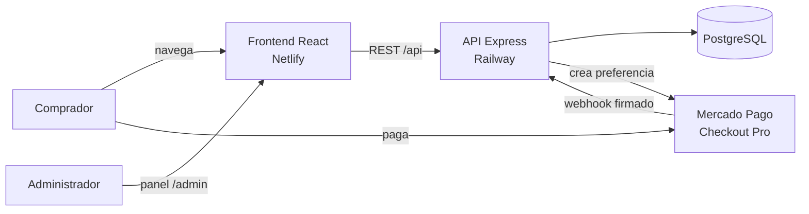
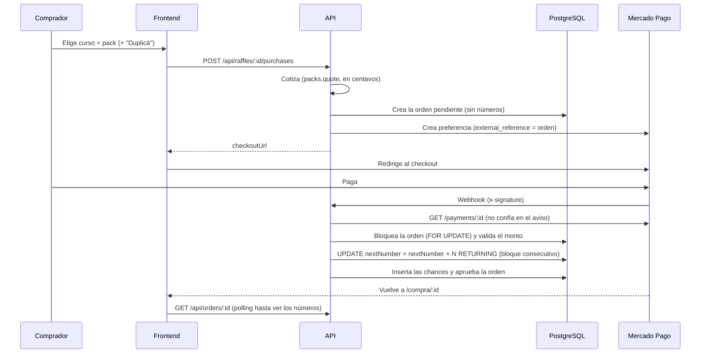

# Arquitectura

## Vista general



## Flujo de compra



## Decisiones

| Decisión | Motivo |
|---|---|
| Números asignados recién al confirmarse el pago | El comprador elige un pack, no números. Sin reserva previa no hay números "tomados" por compras que nunca se pagan, ni vencimientos que administrar. |
| Contador por sorteo con un `UPDATE … RETURNING` atómico | La base serializa los UPDATE sobre la misma fila: pagos simultáneos reciben bloques distintos. Se evita "leer y después escribir", donde aparecen los duplicados. |
| Índice único `(RaffleId, number)` | Red de seguridad: la base rechaza un número repetido aunque haya un bug en la lógica. |
| El contador nunca retrocede | Un número anulado (reintegro, contracargo) no se vuelve a asignar: cada número identifica una sola compra para siempre. |
| Consultar el pago a Mercado Pago en el webhook | El cuerpo del aviso no es confiable; se valida firma, estado y monto contra la API. |
| Webhook idempotente con la orden bloqueada | Mercado Pago reintenta avisos; procesar dos veces el mismo pago no asigna números de nuevo. |
| Estado `needs_review` | Pagos con un monto distinto al de la orden quedan para revisión manual y reintegro. |
| Total calculado en el backend, en centavos enteros | El total que se cobra nunca depende del navegador, y no hay errores de coma flotante. |
| Ahorro calculado contra el pack más chico | Se muestra un ahorro real (precio por chance), no precios "antes" inventados. |
| Packs que conservan su id al editarse | Las compras los referencian; se actualizan, crean y borran dentro de una transacción. |
| PDF validado por contenido y descargado con un JWT de propósito único | Un archivo renombrado no pasa como PDF, y un token de sesión no sirve como link de descarga. |
| Tests de concurrencia contra PostgreSQL en el CI | SQLite no admite transacciones en paralelo; la garantía se prueba en la misma base que producción. |
| Marca como configuración (`brand.js`) | El mismo código sirve para varios clientes; los datos de cada cliente quedan fuera del repo. |
| Modo demo con API simulada | Permite mostrar el producto completo sin servidor ni cobros reales. |

## Estructura

```
backend/
  src/
    config.js            variables de entorno
    db.js                modelos Sequelize: Raffle, Pack, Course, Order, Chance
    routes/              public, admin, courses, webhooks
    services/
      packs.js           packs, oferta "Duplicá" y cotización (única fuente del total)
      purchases.js       compra de curso + pack y confirmación del pago
      numbers.js         asignación de números consecutivos
      orders.js          sorteos, webhook, venta manual, ganador, estadísticas
      courses.js         cursos y links de descarga firmados
      storage.js         almacenamiento de archivos (disco hoy, S3/R2 después)
      mercadopago.js     preferencia, consulta de pago, firma del webhook
  test/                  tests de integración (node:test + supertest)
frontend/
  src/
    brand.js             nombre, colores, logo y redes del cliente
    pages/               landing, compra, estado, bases, links, admin
    components/          editor de packs, barra de progreso, redes
    demo/                API simulada para la demo
```
