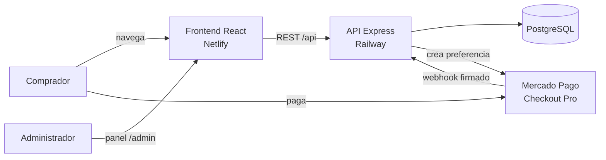
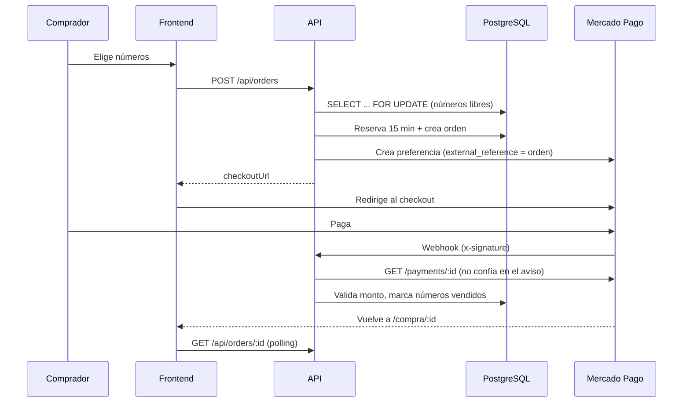

# Arquitectura

## Vista general



## Flujo de compra



## Decisiones

| Decisión | Motivo |
|---|---|
| Bloqueo de filas con `SELECT … FOR UPDATE` | Dos compradores no pueden quedarse con el mismo número aunque compren en el mismo milisegundo. |
| Reserva con vencimiento (15 min) | El número queda tomado mientras se paga, y se libera solo si no se paga. |
| Consultar el pago a Mercado Pago en el webhook | El cuerpo del aviso no es confiable; se valida firma, estado y monto contra la API. |
| Webhook idempotente | Mercado Pago reintenta avisos; procesar dos veces el mismo pago no duplica ventas. |
| Estado `needs_review` | Pagos con monto distinto o acreditados después de que el número se vendió quedan para revisión manual y reintegro. |
| Medios en efectivo excluidos | Se acreditan días después, cuando la reserva ya venció. |
| Precio con promos calculado en el backend | El total que se cobra nunca depende del navegador. La misma función corre en el frontend solo para mostrarlo. |
| Marca como configuración (`brand.js`) | El mismo código sirve para varios clientes; los datos de cada cliente quedan fuera del repo. |
| Modo demo con API simulada | Permite mostrar el producto completo sin servidor ni cobros reales. |

## Estructura

```
backend/
  src/
    config.js            variables de entorno
    db.js                modelos Sequelize
    routes/              public, admin, webhooks
    services/
      orders.js          reservas, pagos, vencimientos, venta manual
      pricing.js         promos por cantidad (programación dinámica)
      mercadopago.js     preferencia, consulta de pago, firma del webhook
  test/                  tests de integración (node:test + supertest)
frontend/
  src/
    brand.js             nombre, colores, logo y redes del cliente
    pages/               landing, compra, estado, links, admin
    components/          promos, redes
    demo/                API simulada para la demo
```
